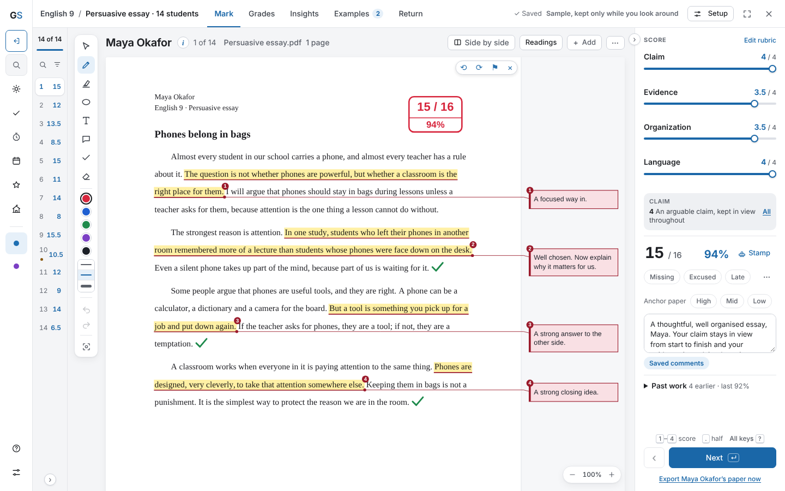
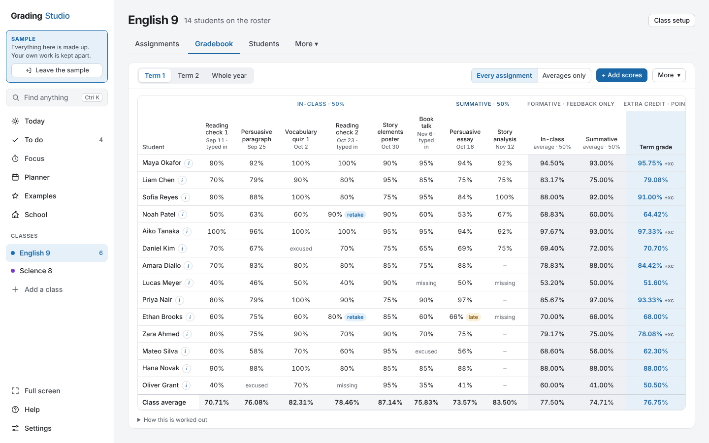
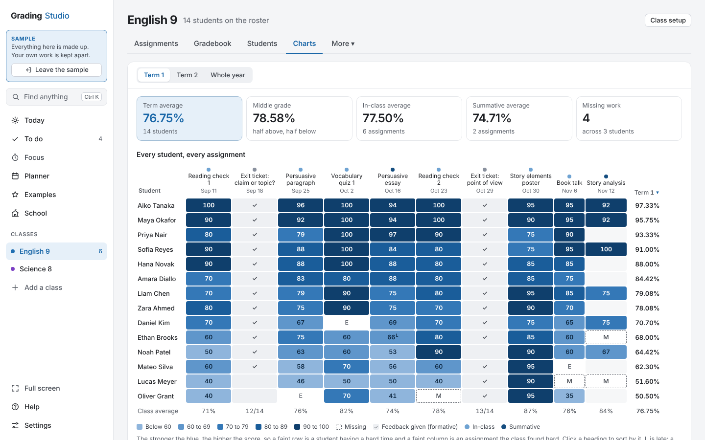
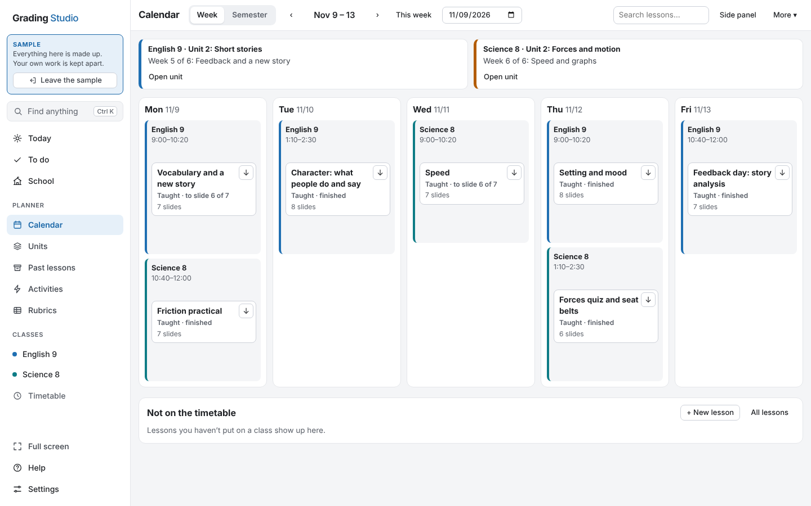

# Grading Studio

A free grading tool and lesson planner for teachers that runs in your web browser. You open student papers, mark them with a pen, score them, keep a gradebook and hand the marked files back. Beside it, a Planner holds your units, lessons and slides.

There is no account, no sign-up and nothing to install. Student work stays on your own computer.

**Open it:** https://taylorbereiter.github.io/grading-studio/ in Chrome or Edge.

**Version 2** is a new Grading Studio at the same link, with the same saved work. The version before it stays at https://taylorbereiter.github.io/grading-studio/classic/ for anyone who needs it for a while: **Settings, About** has a link to it, and it has a link back. Both open the same classes, papers and lessons, so a change made in one shows in the other. Old bookmarks, including the Planner's, open the matching screen of the new version.

Not ready to use it with real classes? On the first screen, click **Look around with a sample class first**. It opens two made-up classes part-way through a term, with marked papers, a gradebook, charts and a week of lessons. The sample is kept apart from your own work, and **Leave the sample** clears it.



## Start in five minutes

1. Open the link. A new browser asks three questions: what you teach, how you grade, and where your work should be kept. You can change every answer later in Settings.
2. Download an assignment's submissions from your school's system and drop the ZIP on the Today screen. A folder, loose files, or one scan of the whole class's papers work too.
3. Mark and score. **Enter** goes to the next paper.
4. The **Grades** tab lists every score to copy into your school's system, and **Return** makes the marked files to send back.

## Your students' privacy

- Papers, names, marks, scores and comments are kept in your browser and, if you choose one, in a folder on your own computer. Nothing is uploaded to a server.
- Opening the app asks the address it is served from which version is newest. Nothing about you or your work is sent.
- Once a day, the copy at the web address adds one to a public count of browsers that opened it (`abacus.jasoncameron.dev`, a free counter with no account), so the maker can see whether anyone uses the app. Only the visit is counted: no name, no setting and nothing about your work goes with it. Like any web request, the counter sees the internet address and the browser's name. It never runs in the sample or in the downloaded copy (`src/visits.js`).
- Using an AI assistant is optional and manual. The app can make a file with student names covered and a random code for each student, and the key to the codes stays in your browser. Nothing is sent to an assistant unless you upload that file yourself.

## What it does

- **Mark** PDFs, Word files, photos and scans with a pen, highlighter, typed text, margin comments, check marks and proofreading marks. Audio and video submissions play beside the paper.
- **Score** with rubric rows (half points too), plain points or a percent. Letter grades can be worked out from the percent, with boundaries you set.
- **IB classes**: an MYP class is marked against its criteria, 0 to 8, with a best-fit level per criterion and a final grade of 1 to 7. A DP class gets 1 to 7 from boundaries you set.
- **Gradebook and charts**: every assignment for a class in one table, with your own terms, types and weights, and charts for each class and each student. Missing work, retakes and extra credit are tracked.
- **Hand work back**: one click makes the marked files, in the same student folders they came in, or one PDF per student.
- **Plan and teach**: the Planner keeps units, lessons and slides beside your timetable. Present a lesson full screen with its agenda and a timer, and note where the class got to. Lessons also download as PowerPoint files.
- **Around the class**: a seating chart with a random name picker and groups, report comment drafts made from the gradebook, one-page progress sheets for parent meetings, and a to-do list.
- **Planning your grading time**: a focus timer with a daily goal, an estimate of how long a set of papers will take at your own pace, your free periods marked on Today, and a tracker of time spent grading and planning, kept in your browser.
- **Undo** (Ctrl Z) works on every screen, including the slide editor.
- **Languages**: the main screens can be shown in Traditional Chinese, Simplified Chinese, Spanish, French, German, Portuguese, Japanese or Korean. None has been checked by a fluent speaker yet, and some screens are still in English.



## Works for any teacher

Nothing about a school, a timetable or a grading scale is built in. Your classes, rosters, terms, weights, timetable, grading scale and links all come from your own Settings. A test opens a brand-new browser and fails if anything shows up that the teacher didn't type.

- **My setup** (in Settings) can bring your whole setup in at once. It gives you a prompt to copy into whichever AI assistant you use. You answer its questions, paste its reply back, see a preview, and can undo it afterwards. No student data comes in this way.
- **Where papers can come from**:

| From | What to drop on Today |
|---|---|
| ManageBac | The ZIP of submissions, or the unzipped folder: one folder per student. |
| Google Classroom | The assignment's Drive folder, downloaded as a ZIP. Settings can also bring a whole class over from Classroom's grades file. |
| Canvas | "Download submissions": each student's files are grouped by the name Canvas puts at the start of each file name. |
| Moodle | "Download all submissions", as folders or as loose files. |
| Microsoft Teams, Schoology, anything else | A ZIP or folder with one folder (or one file) per student. |
| Paper | One scan of the whole stack: **Split a scan of everyone's papers** deals the pages out to students. |
| Email | **+ Add → Pasted text** turns text a student sent you into a page to mark. |

With a class roster pasted in, students are listed in your roster's order and matched to their files by name.



## Keeping your work safe

Because your work lives in your browser, clearing the browser's site data would remove it. The sidebar says **Not backed up** until you choose a folder on your computer. Once you do, every save also goes to that folder, with a copy of each day that **Go back in time** (in Settings) can restore. A **take-home file**, protected by a passphrase, carries everything to another computer and back.

Installed as an app (Settings, About), Grading Studio opens without internet, and a new version waits until you click **Update now**. An app installed before version 2 stays installed and moves to the new version the same way. The previous version can still be downloaded as `classic/Grading Studio.html` from this repository and double-clicked to run with no internet at all.



## Shared as is

Grading Studio was made by one teacher for their own classes and is shared in case it helps others. It is free to use, change and share under the [MIT license](LICENSE). There is no support promise: issues and suggestions are welcome, but they may not get an answer or a fix. Please try it with the sample class or made-up files before trusting it with a term's grades, and keep a backup folder.

**Help** in the app's sidebar answers common questions, and [the full guide](docs/GUIDE.md) covers every screen, tool and shortcut.

## For developers

The app at the root (`index.html`, `dist/`, `sw.js`) is built from `next/src` by `next/build.js`; [next/docs](next/docs) describes it, and [next/docs/sw.md](next/docs/sw.md) how its worker took over from the previous version's. The previous version is plain HTML, CSS and JavaScript, built into single files in `classic/` (`index.html`, `Grading Studio.html` and `planner.html`) by `build.js`. There is no server.

```
npm install
npm run preview   # builds, then serves at http://localhost:4173
npm run check     # builds the previous version and runs its tests (about 15 minutes, needs Chrome)
npm run next:check   # builds the new app and runs its checks
npm run rehearsal    # work made before the switch, carried into this build (needs both built)
```

Use the preview address, never the live one, for trying changes: browsers keep saved work per address, so a preview at the same address as the live link would open real student work. [docs/DEVELOPING.md](docs/DEVELOPING.md) covers the build, the tests, screen and saved-work checks, versions, moving to a new web address and changing how work is saved. [docs/PLAN.md](docs/PLAN.md) holds the plan. To run your own copy at another address, change `address` in `site.json`.

The libraries built into the pages keep their own licenses.
